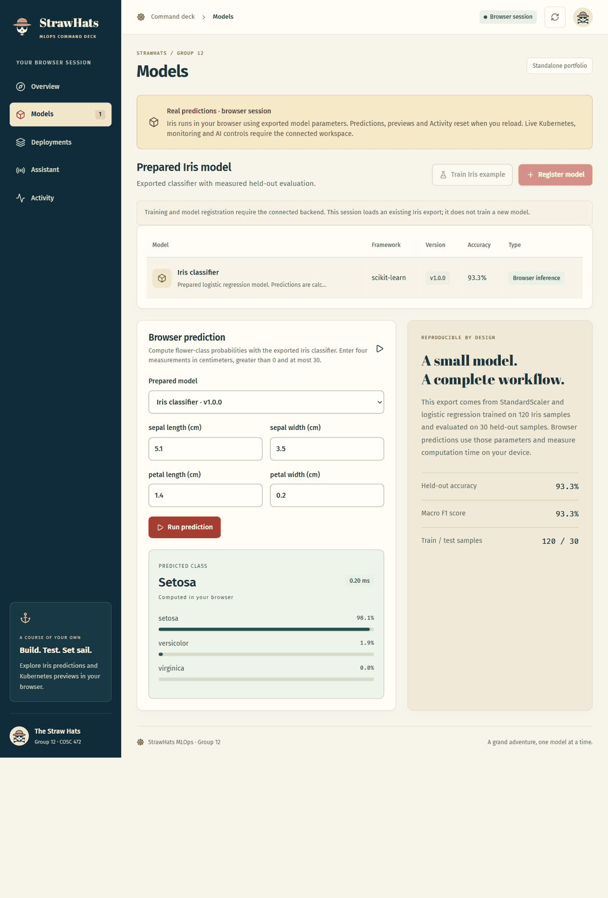

# StrawHats MLOps

**COSC 472 · Group 12 · Straw Hats**

A model operations dashboard for registering ML models, testing inference, preparing Kubernetes deployment configuration, and asking for deployment guidance through LangChain. The owner workspace connects the group's ML Deployment Orchestrator to a verified Kubernetes runtime.

**Live demo:** [strawhats-mlops.vercel.app](https://strawhats-mlops.vercel.app)

**Status:** the public standalone dashboard computes real browser predictions and exports Kubernetes previews without a backend. The connected local dashboard supports verified Iris deployment, scaling, rollback, inference and monitoring on Docker Desktop. The owner-run bounded AI resource-adjustment command is implemented; its acceptance results are documented below. AWS deployment and the complete cloud demonstration remain unfinished.

## Team

| Member | Responsibility |
| --- | --- |
| Great-Anthony Umukoro ([GreatlyDev](https://github.com/GreatlyDev)) | UI, integration, deployment and release decisions |
| Mikayla Brown ([KaylaBro0](https://github.com/KaylaBro0)) | Registry validation and persisted per-model prediction summaries |
| Mahki Titus ([Mahki7](https://github.com/Mahki7)) | Assistant responses, input validation and bounded workspace context |

Each teammate reviews, tests, and commits their contributions through feature branches and pull requests.

## Features in this release

- One Piece-inspired responsive React dashboard with parchment panels, nautical branding, and Overview, Models, Deployments, Assistant, and Activity.
- Persistent SQLite model/container registry and timeline.
- Read-only per-model prediction summaries with persisted counts, label distribution and latest-30 latency/history.
- Reproducible Iris classifier with held-out evaluation and real local predictions.
- Kubernetes Namespace, Deployment, and Service YAML previews with selected resources, replicas, probes, and nonroot settings; copy/download support.
- Read-only cluster reachability check that reports the actual local context.
- Observed prediction counts/latency and Prometheus endpoints.
- LangChain/OpenAI guidance with server-only credentials and actionable provider errors.
- Standalone Iris model service verified in a hardened Linux container.
- Namespaced Python Kubernetes operator with a bounded ModelDeployment CRD, verified local scaling and explicit rollback; see [local operator setup](infra/kubernetes/operator/README.md).
- Opt-in private Iris dashboard controls, bound to one configured local/rehearsal/EKS release; accepted requests remain Pending until the operator observes the change.
- Deployed Iris predictions through the fixed local Kubernetes Service, with measured probabilities, model latency, and deployment provenance.
- Local Iris serving telemetry, one provisioned Prometheus/Grafana dashboard, Kubernetes pod resource readings and a bounded prediction-concentration warning demo; see [local monitoring setup](infra/kubernetes/monitoring/README.md).

Container registrations store metadata. The name/version Iris classifier v1.0.0 is reserved for the built-in example. Local inference supports the bundled Iris example; external images require a separately deployed endpoint. Previews do not apply workloads to a cluster.

The [owner release guide](infra/README.md) covers the CI-gated two-image release,
private runtime selection, dedicated local rehearsal and UID-checked cleanup.
Cloud preparation and simulated provider tests do not establish live AWS or live
AI acceptance; those remain required before claiming the assignment complete.

## Architecture

```text
React / TypeScript / Vite dashboard
             │ /api (local Vite proxy)
             ▼
FastAPI ── SQLite + local trained artifact
  ├── model registry, inference, measured metrics
  ├── Kubernetes YAML preview + read-only kubectl health
  ├── Local Iris bridge → docker-desktop ModelDeployment + Iris Service inference
  └── LangChain ── OpenAI (only on assistant submission)

Standalone model service: /health, /predict, /metrics
Local Kubernetes: ModelDeployment CRD → Python operator → Iris Deployment/Service
Local monitoring: Iris /metrics → Prometheus → Grafana + concentration alert
Standalone portfolio: exported Iris → browser inference + session YAML previews
Owner tools: bounded LangChain adjustment + CI-gated cloud release preparation
```

The connected dashboard does not receive provider keys. Its local records and trained artifacts live in `.local/`, which is excluded from Git. Prometheus counters reset with the process; workspace totals persist in SQLite. Median latency covers the last 30 recorded predictions.

## Runtime modes

The mode is chosen explicitly when Vite starts or builds. `VITE_APP_MODE` defaults to `workspace`; an API outage remains an error and never switches modes.

| Feature | `workspace` | `portfolio` |
| --- | --- | --- |
| Iris predictions | Trained backend artifact; deployed model in Local Iris | Real computation in the browser using exported parameters |
| Models | Persistent registry and training | One prepared Iris example; no training or registration |
| YAML previews | Saved in SQLite; copy/download | Up to 50 saved per page session; copy/download |
| Overview and Activity | Backend records and measured workspace predictions | Actual browser actions; last 30 predictions and 50 events |
| Kubernetes and monitoring | Connected local operator and serving telemetry | Unavailable; previews make no cluster changes |
| AI assistant | Server-side provider configuration required | Unavailable; no prompts or provider requests |

Portfolio state is held in memory for the current page session. Navigation within the dashboard preserves it; reload or opening a new page starts over. Latency measures computation on the visitor's device, not a network round trip. Browser mode does not connect to the API, Kubernetes or an AI provider.

The public model asset exports the existing StandardScaler/logistic-regression pipeline, actual evaluation metrics, feature/class ordering and source provenance. It is prepared before publication; loading it is not new training. Numerical tests compare all 150 Iris dataset rows, walkthrough inputs and boundary cases against independently computed Python probabilities within `1e-10`. Exported parameters use 12 decimal places; oracle probabilities use 11 to avoid cross-platform rounding-boundary differences.

To build and preview the standalone site locally from `frontend` in PowerShell:

```powershell
$env:VITE_APP_MODE = 'portfolio'
$env:VITE_API_BASE_URL = ''
npm.cmd run build
npm.cmd run preview
```

Open [the portfolio preview](http://127.0.0.1:4173). Run predictions in Models, enter a draft serving-image reference in Deployments, generate/export its YAML, and inspect session counts and Activity. Draft references are not proof that an image exists or is runnable.

For connected development, stop the preview, remove those overrides and start the backend and frontend as described below:

```powershell
Remove-Item Env:VITE_APP_MODE, Env:VITE_API_BASE_URL -ErrorAction SilentlyContinue
```

In a POSIX shell, use `VITE_APP_MODE=portfolio VITE_API_BASE_URL= npm run build`. Rebuild after changing modes; `vite preview` serves the already built mode. Unsupported mode values and portfolio builds with a nonempty `VITE_API_BASE_URL` fail with a configuration error.

Regenerate or verify the public assets from the repository root with the locked backend dependencies installed:

```powershell
.\.venv\Scripts\python.exe -m scripts.portfolio.export_iris
.\.venv\Scripts\python.exe -m scripts.portfolio.export_iris --check
```

This also maintains the independent backend YAML oracle used by preview tests. These three public JSON assets are intentional source files; private trained artifacts and workspace data remain ignored.

## Requirements and setup

Use Python 3.12 and Node 24 (or Node 22.12+). Docker and kubectl are optional for this local release and required for later container/cluster verification.

From the repository root on Windows:

```powershell
python -m venv .venv
.\.venv\Scripts\python.exe -m pip install -r backend\requirements-dev.txt -r backend\requirements-operator.txt
if (-not (Test-Path .env.local)) { Copy-Item .env.example .env.local }
cd frontend
npm.cmd ci
cd ..
```

If `.env.local` already exists, preserve it. Add your own `OPENAI_API_KEY` there only if you need the assistant. `OPENAI_MODEL` defaults to `gpt-4.1-mini`. The registry, inference, metrics, and previews work without an API key. API billing/credits are required for a successful provider request.

The checked-in `backend/requirements-lock.txt` records the verified local environment, including dev tools. `scikit-learn==1.7.2` and `uuid-utils==0.12.0` avoid native library incompatibilities encountered on the development Windows machine.

In two PowerShell terminals from the repository root:

```powershell
# Terminal 1
.\scripts\start-backend.ps1
```

```powershell
# Terminal 2
.\scripts\start-frontend.ps1
```

Open [the dashboard](http://127.0.0.1:5173) and [API documentation](http://127.0.0.1:8000/docs). Both development services bind to loopback. On macOS/Linux use `.venv/bin/python` and run the equivalent uvicorn/npm commands directly.

## Local walkthrough

1. Open Models and select **Train Iris example**.
2. Inspect the measured held-out accuracy and macro F1.
3. Run a prediction with measurements `[5.1, 3.5, 1.4, 0.2]`; inspect the label, probabilities, and measured latency.
4. Open Deployments, select a registered model in the manifest configuration, and enter an image you control. Generate and inspect the YAML. This saves a preview only.
5. Open Overview/Activity to see real counts and recorded events.
6. Submit a deployment question in Assistant when API credits are available.

For Iris, features are sepal length, sepal width, petal length, and petal width in centimeters. The bundled [scikit-learn Iris dataset](https://scikit-learn.org/1.7/datasets/toy_dataset.html#iris-plants-dataset) has 150 observations and 3 classes. A stratified split uses 120 training and 30 held-out test samples with seed 42. StandardScaler is fitted inside the training pipeline; logistic regression is evaluated on the held-out samples. These scores describe this educational dataset, not production model quality.

## Verification

```powershell
.\.venv\Scripts\python.exe -m pytest backend/tests -q --disable-plugin-autoload
.\.venv\Scripts\python.exe -m ruff check backend scripts/cloud scripts/monitoring scripts/portfolio
.\.venv\Scripts\python.exe -m ruff format --check backend scripts/cloud scripts/monitoring scripts/portfolio
.\.venv\Scripts\python.exe -m pip check
.\.venv\Scripts\python.exe -m scripts.portfolio.export_iris --check
cd frontend
npm.cmd test
npm.cmd run format:check
$env:VITE_APP_MODE = 'workspace'
$env:VITE_API_BASE_URL = ''
npm.cmd run build
$env:VITE_APP_MODE = 'portfolio'
npm.cmd run build
Remove-Item Env:VITE_APP_MODE, Env:VITE_API_BASE_URL
```

Tests exercise persistence, input rejection, real predictions, manifest contents, measured metrics, provider error handling, model-service health/inference, and browser API transport. No provider calls or cluster writes occur during tests. Browser verification covers local training, inference, YAML export, navigation, and responsive layouts.

## Containers and deployment

### Local Iris dashboard controls

Install the [local operator](infra/kubernetes/operator/README.md), including the
verified `strawhats-iris:local-monitoring` image. Install
`backend/requirements-operator.txt` in the backend environment. Set
`LOCAL_OPERATOR_ENABLED=1` in `.env.local` and restart the backend, then open
**Deployments → Local Iris**.

- **Deploy Iris** creates or updates `iris` using the verified image, selected
  1–2 replicas, 250m CPU and 256Mi memory requests.
- **Scale Iris** changes 1–2 replicas only after the requested configuration is
  verified ready. Scaling after rollback preserves the restored image/resources.
- **Rollback Iris** requests the operator's most recent verified snapshot. It
  restores that snapshot after a failed rollout; each successful configuration
  replaces the snapshot.
- **Predict with deployed Iris** sends four flower measurements in centimeters
  through the Kubernetes API proxy to the owned `iris:8000` Service. It requires
  a current Ready/RolledBack generation and at least one ready replica; no
  separate port-forward or workspace model registration is needed. Results show
  the deployed model's probabilities, processing time, image, and generation.
  Service failures show an error without substituting a workspace prediction.
- The panel polls observed status while visible. An accepted request is not a
  completed rollout; unavailable/stale status pauses controls. Activity records
  describe requests, while readiness comes from the controller.

Lifecycle actions write only the ModelDeployment specification in context
`docker-desktop`, namespace `strawhats-operator-local`, name `iris`. The backend
requires a loopback caller/host and a verified local Kubernetes HTTPS endpoint.
Controls default to disabled; this local development flow does not create AWS
resources. Manifest previews retain their existing export-only behavior.

The **Models → Workspace prediction** form runs the workspace artifact and
updates Overview's workspace inference count. Deployed predictions instead
increment the serving model's `strawhats_model_predictions_total` metric and
record a completed Kubernetes prediction in Activity; they do not change that
workspace count. Deployment provenance describes the revision observed when the
request began, and model time excludes the dashboard/proxy network round trip.

The Models tab still uses the workspace's local predictor. To verify the
Kubernetes-served model separately, port-forward its Service to loopback and run
the existing smoke checks; this milestone does not reroute Models-tab inference.

### Bounded local AI resource adjustment

Start the existing local operator, Iris and [monitoring setup](infra/kubernetes/monitoring/README.md),
including the loopback Prometheus port-forward on port 9090. Use Python 3.12 and
the existing backend/operator requirements. Keep `OPENAI_API_KEY` and optionally
`OPENAI_MODEL` (default `gpt-4.1-mini`) in the ignored root `.env.local`.

```powershell
# Read-only by default; a valid eligible decision uses one OpenAI API call.
.venv/Scripts/python.exe -m scripts.optimization.adjust_iris
# Explicitly permit one resource change, followed by readiness/inference checks.
.venv/Scripts/python.exe -m scripts.optimization.adjust_iris --apply
```

The command only targets `docker-desktop`, namespace `strawhats-operator-local`,
`ModelDeployment/iris` with the monitoring image. It requires fresh complete
per-pod observations, at least 20 recent predictions, an inactive concentration
warning and the current ready revision. Raw measurements, recording-rule
dependencies and relevant rule evaluations must be at most 45 seconds old
(allowing five seconds of clock skew); query evaluation time alone is insufficient.
No eligible change, an active five-minute
cooldown or missing credentials makes no AI request. Generate balanced real
predictions before running it; do not fabricate metrics or repeatedly call until
the AI agrees to change a setting.

Deterministic policy offers one-step CPU requests of 100/250/500m or memory
requests of 128/256/512Mi. It uses the busiest pod: CPU increases at 75% request
utilization and decreases at 20% only with at most 50% utilization of the smaller
request; memory increases at 80% and decreases at 50% only with at most 60%
utilization of the smaller request. CPU or memory pressure excludes decreases.
The existing operator sets limits to twice the requests (at most 1000m/1024Mi).
One command changes at most one field; image, replicas and the other request stay
fixed. LangChain/OpenAI selects an offered action or Hold, never commands or YAML.
These bounds are project guardrails, not performance or cost guarantees.

After the decision, the command rechecks the revision, pod UIDs, fresh metrics and
eligibility within 60 seconds. One optimistic patch includes UID/resourceVersion
and two cooldown annotations; conflicts and uncertain write outcomes never retry.
It waits at most 180 seconds for that exact observed revision, ready owned pods
and endpoints, and a valid prediction through the Iris Service. A definite failed
rollout permits one restoration of the captured prior settings only while the
written UID/generation/spec/run ID still match, with another 180-second verification
bound. A newer manual change is never overwritten. Hold/preview paths make no
cluster writes. This command adds no scheduler or public management endpoint.

Sanitized timestamped evidence, including prior settings, is stored atomically
under ignored `.local/optimization/` before mutation. Exit status is zero for
`held`, `preview`, or verified `applied`; `restored` means the adjustment failed
but recovery verified, while `unavailable`/`unresolved` require inspection and
exit nonzero. Evidence and provider credentials must remain outside Git.

The operator's `lastReadySpec` is the **latest ready** configuration. Dashboard
rollback after a successful adjustment does not recover an older historical
configuration; the command's evidence retains the pre-adjustment settings.

Local automated acceptance covers policy thresholds, real LangChain request
serialization, concurrency conflicts, invalid/stale observations, bounded waits,
failed rollouts and guarded restoration through controlled external transports.
On October 15, 2026, 60 genuine balanced Service predictions produced healthy
two-pod telemetry and an eligible CPU decrease from 250m to 100m. The single live
OpenAI preview request was rate-limited, so no adjustment was applied and no second
provider call was made. **Live AI-selected adjustment/readiness acceptance remains
pending.** Restoration/conflict behavior is verified in automated transport tests,
not by deliberately breaking the running cluster. The public dashboard remains
independent of this provider and local cluster.

Build from the repository root after starting Docker:

```powershell
docker build --platform linux/amd64 -f backend/Dockerfile.model -t strawhats-iris:0.1.0 .
docker run --rm --read-only --tmpfs /tmp:rw,noexec,nosuid,size=64m,uid=10001,gid=10001 --cap-drop ALL --security-opt no-new-privileges --cpus 0.5 --memory 512m -p 127.0.0.1:8001:8000 strawhats-iris:0.1.0
# In another terminal:
.\.venv\Scripts\python.exe -m scripts.cloud.smoke --base-url http://127.0.0.1:8001
```

The model image runs as UID 10001 and exposes `/health`, `/predict`, and `/metrics` on port 8000. On October 11, 2026, the Linux/amd64 image passed real prediction, input rejection, and metrics checks before and after a container restart under these security and resource limits. Observed memory use was approximately 96 MiB. Held-out accuracy and macro F1 were both 0.9333; the sample above predicted setosa with confidence 0.9808. These are local observations; AWS deployment remains pending.

The fixed one-replica workload in `infra/kubernetes/iris` renders with `kubectl kustomize infra/kubernetes/iris`. Use an immutable registry digest before applying it to a cloud cluster.

The [EKS release instructions](infra/README.md) cover the prepared one-worker AWS template and guarded Python commands. Cloud creation is deferred until the presentation window and usage budget are approved. No AWS runtime or Kubernetes model-serving endpoint is verified yet.

`backend/Dockerfile` is a separate orchestrator API image. It needs persistent storage for `/app/.local` and runtime environment secrets. It does not include kubectl. Do not deploy the current management API publicly until authentication/authorization, request budgets, shared persistence, and production CORS are implemented.

The public Vercel project uses `frontend` as its root directory, Vite, Node.js 24, `npm ci`, `npm run build`, and output directory `dist`. Set `VITE_APP_MODE=portfolio` and leave `VITE_API_BASE_URL` empty or unset. This build needs no running backend or cluster. Only public configuration belongs in Vite variables; provider credentials stay on the server. Kubernetes controls remain in the owner's connected workspace. The Kubernetes operator and model workloads run in Kubernetes.

## Contributing

Create feature branches from `main` and propose changes through pull requests. **Keep feature branches after merging.** Great-Anthony Umukoro coordinates frontend changes, integration, and releases.

Read the [API contract](docs/api-contract.md) before changing backend interfaces. GitHub Actions runs backend tests/lint and frontend tests/build on pushes and pull requests. Use the verification commands above before opening a PR.

Format frontend changes with `npm run format` in `frontend`, and backend changes with `python -m ruff format backend` from the repository root.

Commit source, tests, maintained documentation, dependency lock files, build configuration, the reproducible public portfolio model/test fixtures and the intentional public demo GIF. Keep credentials, local data, private generated artifacts, planning notes, and teammate handoff packages out of Git. `.env.example` contains placeholders only; real environment files stay local.

## Live demo and GIF

Open [the public standalone demo](https://strawhats-mlops.vercel.app). No sign-in is required. In **Models**, run the default Iris input for setosa, then try `[6.7, 3.0, 5.2, 2.3]` for virginica. In **Deployments**, enter a draft serving-image reference, generate a preview, and copy or download its YAML. **Activity** records those actual browser actions; reload starts a fresh session.

The following GIF sequences actual screenshots captured from the public site on October 15, 2026: real predictions, an exported preview, session Activity and measured Overview counts. It shows the standalone workflow; AWS deployment, live cluster operations and automated AI adjustment are not demonstrated in this recording.



The connected workspace remains available locally at `http://127.0.0.1:5173` using the setup above. The full cloud demonstration will be recorded after EKS deployment and its acceptance checks pass. The public site remains useful when that temporary cluster is shut down.

## License

No license has been selected yet. Third-party packages and dataset terms remain governed by their respective licenses.
